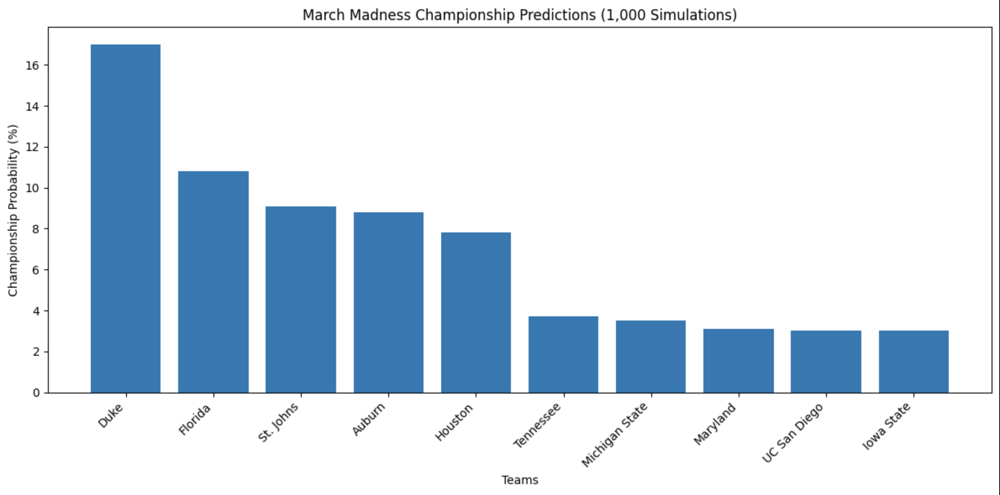

# March Madness Bracket Simulator 🏀

A Python-based March Madness tournament simulator that uses college basketball statistics, probability, and randomized outcomes to predict potential NCAA Tournament champions.

## About the Project

Every year, my friends and I compete in a March Madness bracket challenge, and I wanted to find a way to get a leg up on the competition using my computer science knowledge.

Instead of relying solely on basketball knowledge, I decided to build a program that uses actual team statistics to help predict the outcome of the NCAA Tournament.

The goal was simple: **use data and programming to build a more competitive March Madness bracket.**

Over the years, I've continued updating and improving the simulator as I've gained more programming experience. I've also used the results alongside my own basketball knowledge to make my bracket selections, which have helped me consistently finish around the top five in my friends' bracket competition.

This project has been a fun way to combine two of my interests: basketball and computer science.

## Technologies Used

- **Python:** Main programming language used to build the simulation.
- **NumPy:** Used for probability-based random selection to determine game winners.
- **Matplotlib:** Used to visualize game probabilities and overall championship predictions.
- **Jupyter Notebook:** Used to organize the code, document the process, and display results.
- **Python Random Library:** Used to introduce variability into the statistical weights.

## How the Algorithm Works

The simulator starts with 64 teams organized in their original tournament bracket order. Each team is represented by a dictionary containing its name, seed, and regular-season statistics.

To determine the winner of a matchup, the algorithm evaluates four main statistics:

| Statistic | Purpose |
|---|---|
| Tournament Seed | Gives higher-seeded teams an initial advantage |
| Points Per Game (PPG) | Measures a team's offensive production |
| Opponent PPG Allowed | Measures how many points a team allows defensively |
| Regular-Season Wins | Accounts for a team's overall winning record |

### Calculating Win Probabilities

The `MMSimCalc()` function takes two teams and calculates a weighted score for each one.

Each team receives an initial score based on its tournament seed. Additional points are then awarded based on differences in offensive production, defensive performance, and regular-season wins.

Randomized multipliers are applied to some of these statistics to introduce variability between matchups.

Once both scores are calculated, the algorithm determines each team's probability of winning:

`Team 1 Win Probability = Team 1 Score / (Team 1 Score + Team 2 Score)`

NumPy's `random.choice()` function then selects the winner using those calculated probabilities.

This allows stronger teams to have an advantage without guaranteeing they win every game, leaving room for the upsets that make March Madness so unpredictable.

### Simulating the Tournament

The tournament is simulated using three main functions:

- **`MMSimCalc()`** calculates matchup probabilities and simulates one game.
- **`simulate_round()`** pairs the remaining teams, simulates their games, and returns the winners.
- **`simulate_tournament()`** runs all six rounds of the tournament until one national champion remains.

Each simulation follows the original tournament bracket structure, with winning teams advancing until a champion is determined.

## Running 1,000 Tournament Simulations

Predicting the winner of a single tournament is difficult, especially with the randomness of March Madness.

To get a better understanding of which teams have the strongest chances of winning, I decided to simulate the entire tournament **1,000 times**.

For each simulation, the program:

1. Starts with all 64 teams.
2. Simulates each round using the statistical algorithm.
3. Advances the winning teams through the bracket.
4. Records the national champion.
5. Repeats the process until 1,000 tournaments have been completed.

Afterward, the program calculates each team's estimated championship probability based on how often it won.

For example, if a team wins 150 out of 1,000 simulated tournaments, its estimated championship probability is 15%.

The results are then ranked and displayed in a bar chart showing the 10 teams with the highest estimated championship probabilities.

These results help me identify potential championship contenders, which I combine with my own basketball knowledge when filling out my bracket.

**Important:** These probabilities are estimates generated by my statistical model, not guaranteed predictions or professionally calibrated betting odds.

After running 1,000 tournament simulations, the followingteams had the highest estimated championship probabilities.



## How to Run the Simulator

### Requirements

- Python 3
- Jupyter Notebook or VS Code with Jupyter support
- NumPy
- Matplotlib

### Installation

1. Clone this repository:

   ```bash
   git clone https://github.com/ChandlerPhillips3/MarchMadnessSimulation.git
   ```

2. Navigate to the project directory.
   
   ```bash
   cd MarchMadnessSimulation
   ```
   
4. Install the required libraries:

   ```bash
   pip install numpy matplotlib notebook
   ```

5. Open `MarchMadness_Simulation.ipynb` in Jupyter Notebook or VS Code.

6. Run the notebook cells from top to bottom.

The notebook currently uses the 2025 NCAA Tournament dataset, with archived team data from previous tournament seasons also included.

To experiment with different outcomes, change the random seed or the number of simulations before running the tournament simulation section.

## Project Evolution

This project has gone through several changes since I originally created it.

The earlier versions stored team statistics in individual lists and used a more repetitive approach to simulating tournament matchups.

As I've continued learning and improving my programming skills, I've revisited the project to make the code more organized, readable, and reusable.

Some of the improvements include:

- Converting individual team lists into dictionaries with descriptive keys.
- Separating the game, round, and tournament logic into reusable functions.
- Moving from repeated game trials to individual probability-based game outcomes.
- Adding data validation to catch missing or invalid team statistics.
- Running 1,000 complete tournaments to estimate championship probabilities.
- Adding random seeds to make simulation results reproducible.
- Improving documentation and visualizations.

I've also kept archived datasets and some references to earlier development phases to show how the project has evolved over time.

## Future Improvements

While the simulator has been a useful tool for making my March Madness brackets, there are several features I'd love to incorporate to make its predictions more accurate.

### 1. Account for Major Team Injuries

One of the biggest limitations of the current model is that it doesn't account for injuries.

A team might have great regular-season statistics, but losing a key player before the tournament can completely change its chances of winning.

I'd like to incorporate injury information and potentially assign different weights based on a player's importance to the team.

### 2. Conference Strength and Conference Records

Not all conferences have the same level of competition.

A team with 28 wins in a weaker conference may not necessarily be stronger than a team with 23 wins against much tougher opponents.

In the future, I'd like to incorporate:

- Strength of conference
- Conference wins and losses
- Strength of schedule
- Performance against highly ranked opponents

These additional statistics could help provide a more accurate comparison between teams from different conferences.

### 3. Improve the Prediction Algorithm

Currently, the algorithm uses a weighted scoring system that I developed based on the statistics I thought were most important.

I'd like to experiment with different statistical weights and use historical tournament results to evaluate how well the algorithm performs.

This could eventually include more advanced statistical methods or machine learning models.

### 4. Simulate Individual Game Scores

Rather than only predicting which team wins, I'd like to eventually simulate realistic final scores for each matchup.

This could incorporate offensive and defensive efficiency, pace of play, shooting percentages, and other statistics.

### 5. Work Toward a More Accurate Bracket

My long-term goal is to build a simulator that can analyze every matchup using increasingly detailed data and generate a complete predicted bracket.

Getting a perfect March Madness bracket is incredibly unlikely, but that's part of what makes this project so interesting.

I'd love to continue improving the algorithm, comparing its predictions against real tournament results, and seeing just how close I can get!

## Final Thoughts

This project started as a fun way to try to beat my friends in March Madness, but it has also become a great opportunity to apply and improve my computer science skills.

It has allowed me to work with data structures, probability, algorithms, simulation, data visualization, and code refactoring.

As I continue developing my skills as a software engineer, I plan to revisit this project and experiment with new ways to improve its predictions.

And hopefully, win a few more bracket competitions along the way! 🏆
